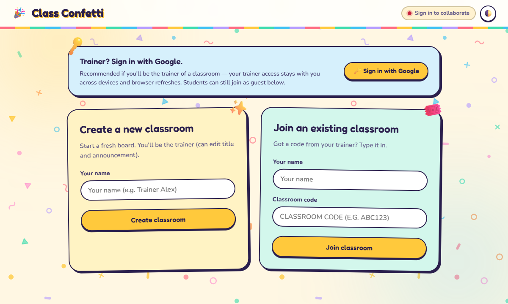
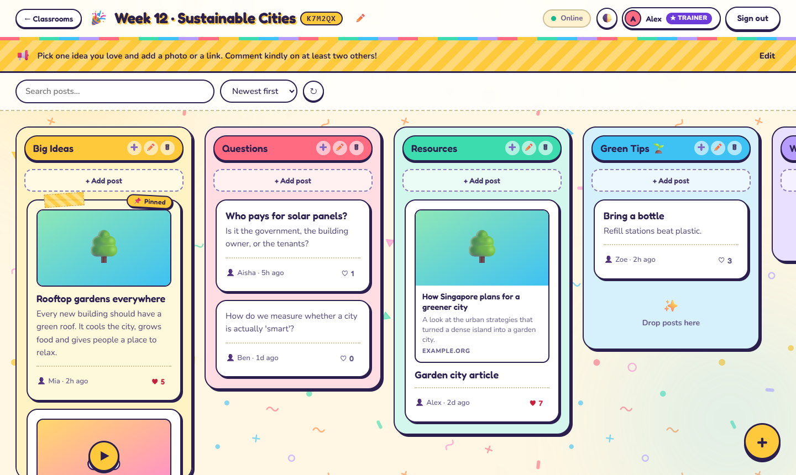
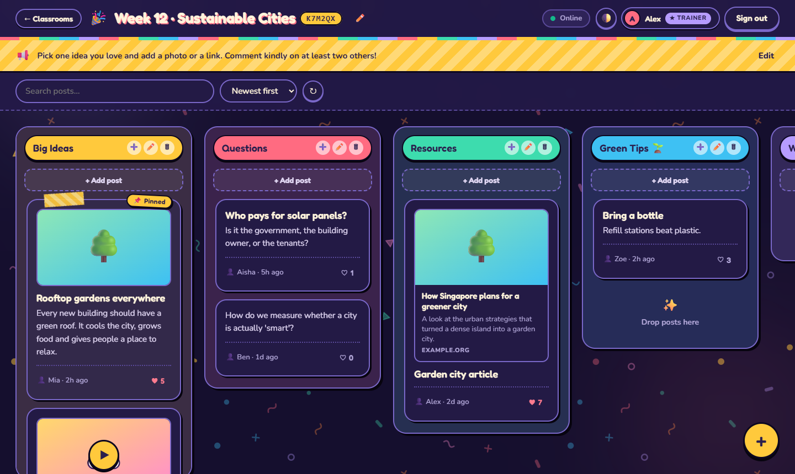

<div align="center">

# 🎉 Class Confetti

**A cheerful, real-time classroom board. Post ideas, images, links and PDFs, and watch the confetti pile up.**

Plain HTML/CSS/JS · Firebase Auth + Firestore · No framework, no bundler

[](https://developer.mozilla.org/en-US/docs/Web/HTML)
[](https://developer.mozilla.org/en-US/docs/Web/CSS)
[](https://developer.mozilla.org/en-US/docs/Web/JavaScript)
[](https://firebase.google.com/)
[](https://firebase.google.com/products/firestore)
[](https://pages.github.com/)



</div>

## What it does

- **Classrooms.** A trainer creates a classroom and gets a 6-character code. Students join with the code or a `?room=CODE` link. Whoever creates a classroom is its *trainer*.
- **Guest or Google sign-in.** Guests just type a nickname. Trainers should sign in with Google so trainer access follows their account across devices.
- **Colourful sections.** A board is a row of columns, with optional sub-sections. Anyone signed in can add a section. Authors drag their own posts between sections, and trainers reorder columns by dragging the header.
- **Rich posts.** Subject, description, multiple images (shrunk in the browser), PDFs (rendered page by page) and links with previews, YouTube thumbnails and embedded players.
- **Real time.** Posts, sections, likes, comments and the announcement banner update live for everyone.
- **Likes, comments, search and sort.** Heart a post, comment on it, search by text or author, sort by newest, oldest or most liked.
- **Trainer tools.** Edit the classroom title and announcement, delete any post or comment in your classroom, or delete the whole classroom.
- **Light and dark themes**, mobile friendly, and motion that respects `prefers-reduced-motion`.

<details>
<summary>More screenshots (sample content)</summary>

These two are the real stylesheet rendered with illustrative sample posts.





</details>

## Quick start

### 1. Set up Firebase

1. In the [Firebase console](https://console.firebase.google.com/), create or pick a project and add a **Web app** (the `</>` icon). Keep its config handy.
2. **Authentication → Sign-in method:** enable **Anonymous** and **Google**.
3. **Firestore Database → Create database**, then publish the rules in [`firestore.rules`](firestore.rules) (see [Firestore rules](#firestore-rules)). Firebase Storage is *not* used: images and PDF pages are stored in Firestore.
4. **Authentication → Settings → Authorized domains:** `localhost` is there by default. Add your deployed domain (for example `your-name.github.io`) before using Google sign-in there.
5. If you restrict your API key by HTTP referrer (recommended, see [About the API key](#about-the-api-key)), allow `http://localhost:8000/*` for development plus your deployed domain. Otherwise sign-in fails with a "requests from referer ... are blocked" error.

### 2. Configure

```bash
cp .env.example .env              # Windows PowerShell: Copy-Item .env.example .env
# open .env and paste your Firebase values
node scripts/generate-config.mjs
```

### 3. Run

```bash
python -m http.server 8000 --bind 127.0.0.1     # Windows: py -m http.server 8000 --bind 127.0.0.1
```

Open <http://localhost:8000>. Edit a file, reload, done. Re-run the `node` command only when `.env` changes.

## Configuration

Browsers can't read a `.env` file, so a small dependency-free script turns it into the module the app imports:

```
.env  ──  node scripts/generate-config.mjs  ──▶  js/config.js  ──▶  js/firebase.js
(yours, gitignored)                              (generated)
```

| Variable in `.env`             | Firebase config key  | Required |
| ------------------------------ | -------------------- | -------- |
| `FIREBASE_API_KEY`             | `apiKey`             | yes      |
| `FIREBASE_AUTH_DOMAIN`         | `authDomain`         | yes      |
| `FIREBASE_DATABASE_URL`        | `databaseURL`        | no       |
| `FIREBASE_PROJECT_ID`          | `projectId`          | yes      |
| `FIREBASE_STORAGE_BUCKET`      | `storageBucket`      | yes      |
| `FIREBASE_MESSAGING_SENDER_ID` | `messagingSenderId`  | yes      |
| `FIREBASE_APP_ID`              | `appId`              | yes      |
| `FIREBASE_MEASUREMENT_ID`      | `measurementId`      | no       |

- Real environment variables win over `.env`. That is how the GitHub Actions deploy can build the config from repository secrets, with no `.env` file at all.
- The script exits with an error naming any missing variable, and never writes a half-filled config.
- If `js/config.js` doesn't exist, the page shows a short "The app couldn't start" hint instead of hanging on "Loading…".
- `FIREBASE_DATABASE_URL` is only for Realtime Database. This app uses Firestore, so it is accepted (so the generated config matches the console snippet) but unused.

### About the API key

Firebase web config identifies your project, it does not grant access to it, and anyone who opens your site can read it from the downloaded `js/config.js`, so committing that file is fine (this repo does). `.env` makes switching projects a one-file change, but the values in it aren't secret. What actually protects your data is:

1. the [Firestore rules](#firestore-rules), and
2. restricting the key under Google Cloud Console → APIs & Services → Credentials → your browser key → *Application restrictions → HTTP referrers*.

The dev server serves the whole project folder, so never put server-side secrets (service-account keys, Admin SDK credentials) in `.env`.

## Deploy to GitHub Pages

1. Push the repo to GitHub, then **Settings → Pages → Source: GitHub Actions**.
2. Give the build your Firebase config, either way:
   - **Commit `js/config.js`** (run `node scripts/generate-config.mjs` first). This is the simplest option and needs no secrets.
   - Or **Settings → Secrets and variables → Actions → New repository secret.** Add one secret per variable in the table above, named exactly the same (`FIREBASE_DATABASE_URL` and `FIREBASE_MEASUREMENT_ID` are optional). If `FIREBASE_API_KEY` is set, the workflow regenerates `js/config.js` from the secrets and ignores any committed copy.
3. Push to `main`. [`deploy-pages.yml`](.github/workflows/deploy-pages.yml) builds the config from the secrets if they are set, otherwise uses the committed `js/config.js`, then publishes the site. The deploy **fails** and says why if there are no secrets and no committed `js/config.js`, or if the secrets are only partly set, rather than publishing a broken site.
4. Add `your-name.github.io` to Firebase **Authorized domains** and to your API key's allowed referrers.

On Netlify, Vercel or Firebase Hosting, set the same variables, use `node scripts/generate-config.mjs` as the build command, and publish the project root.

## Firestore rules

The security rules live in [`firestore.rules`](firestore.rules), the single source of truth. Any signed-in user (guests included) can read. Authors manage their own posts and comments. A classroom's trainer, the user who created its room document, can edit and delete anything in that classroom.

Publish them with the Firebase CLI (nothing to install; it asks you to log in once):

```bash
npx firebase-tools login
npx firebase-tools deploy --only firestore:rules --project YOUR_PROJECT_ID
```

Or paste the file's contents into Firebase console → Firestore → Rules and publish.

> **Sharing a Firebase project?** A Firestore database has exactly one ruleset, so deploying `firestore.rules` replaces whatever is there. If other apps already use this project's Firestore, merge the `match` blocks into your existing rules instead. This app only touches the top-level `posts` and `comments` collections.
>
> Realtime Database rules (`database.rules.json`) are a separate system and are **not** used by this app. [`firebase.json`](firebase.json) lists only Firestore on purpose, so deploying from this repo never touches your Realtime Database rules.

If you change the data model, the rules and the UI must change together, for example when a new field should be editable by anyone rather than only the author.

### How the data is stored

Everything except comments lives in one collection, `posts`, told apart by a `type` field:

| `type`       | What it is                                        | Document id                     |
| ------------ | ------------------------------------------------- | ------------------------------- |
| `room`       | A classroom (title, announcement, trainer)        | the 6-character room code       |
| `membership` | "this user joined this room", for cross-device lists | `mem_{uid}_{roomId}`         |
| `section`    | A board column or sub-column                      | auto                            |
| `post`       | A post, with images stored as compressed data URLs | auto                           |
| `pdf-page`   | One rendered page of a PDF attached to a post     | auto                            |

Comments are in `comments`, keyed to a post by `postId`. No composite indexes are required.

### Good to know

- **Classroom codes are not a security boundary.** The rules let any signed-in user (guests included) read posts, so anyone who can reach your site can read classroom content. Don't use this for sensitive material.
- **Link previews go through public CORS proxies** (corsproxy.io, allorigins.win, codetabs.com), so URLs people paste are sent to those services. Previews are cached in the visitor's browser.
- Limits: images up to 5 MB each (shrunk to 800 px), PDFs up to 10 MB and 80 rendered pages.

## Project structure

```
.
├── index.html                 # Single-page shell, fonts, favicon
├── styles.css                 # The whole theme: design tokens first, light + dark
├── assets/
│   ├── confetti-light.svg     # Seamless background tiles (plain SVG, hand-editable)
│   └── confetti-dark.svg
├── js/
│   ├── main.js                # Boot, state, rendering, event wiring
│   ├── rooms.js               # Classrooms, memberships, sections
│   ├── posts.js               # Posts, likes, PDF page documents
│   ├── comments.js
│   ├── auth.js                # Guest + Google sign-in
│   ├── firebase.js            # initializeApp + auth/db/storage singletons
│   ├── ui.js                  # DOM helpers, modal, toast
│   ├── admin.js               # CSV export helper (currently unused)
│   └── config.js              # GENERATED from .env, committed (public web config)
├── scripts/
│   └── generate-config.mjs    # .env -> js/config.js
├── .env.example               # Template for your Firebase settings
├── firestore.rules            # Firestore security rules (single source of truth)
├── firebase.json              # Points the Firebase CLI at firestore.rules (Firestore only, on purpose)
├── .github/workflows/deploy-pages.yml
└── CLAUDE.md                  # Notes for working on the code with Claude Code
```

## Make it yours

- **Colours, type, shape.** Every colour, radius and shadow is a CSS variable at the top of `styles.css` (`:root` for light, `.dark` for the dark theme). `--sun`, `--coral`, `--mint`, `--sky`, `--grape`, `--tangerine` and `--pink` are the confetti palette, and text on a bright fill is always `--ink`. `--c1` to `--c7` colour the board columns in rotation.
- **Background confetti.** Edit `assets/confetti-*.svg` directly (shapes, colours, opacity).
- **Fonts.** Fredoka (headings) and Nunito (text), loaded from Google Fonts in `index.html`.
- **Name.** "Class Confetti" appears in the `<title>` and footer of `index.html` and as the landing title in `js/main.js`.

## Smoke test

Open two windows side by side (one normal, one private).

1. Window A signs in with Google and creates a classroom. Window B joins as a guest with the code.
2. A adds a section. B adds a post with an image and a link. Both windows show it instantly.
3. B hearts and comments. A sees both live, then deletes B's comment as trainer.
4. B drags their post to another section (A can't move B's post, B can).
5. A edits the title and announcement. B sees them change live.
6. Toggle the theme (🌓) in either window, then search and sort.

## Credits

Based on the classroom board by Tertiary Infotech Academy ([alfredang/padlet](https://github.com/alfredang/padlet)) and inspired by [Padlet](https://padlet.com/). Built with [Firebase](https://firebase.google.com/), [PDF.js](https://mozilla.github.io/pdf.js/), and the Fredoka and Nunito typefaces.
